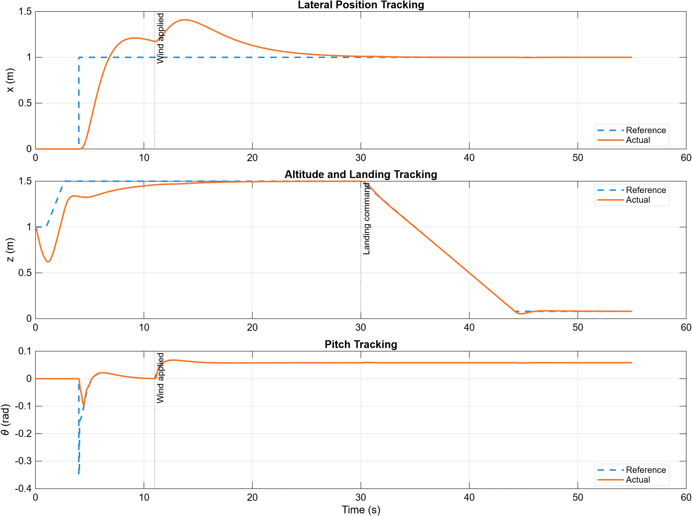
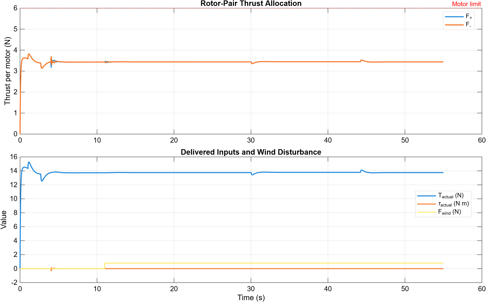

# Robust Quadcopter Precision Landing Controller

A MATLAB/Simulink project that designs and validates an autonomous quadcopter controller for a rate-limited precision landing under simultaneous wind and payload uncertainty.

> **Scope:** The controller uses a nonlinear planar flight model with horizontal position `x`, altitude `z`, and pitch `theta`. Simscape Multibody provides the 3-D animation. This is not a full six-degree-of-freedom model and ground-contact forces are outside the present scope, so the final reference holds a small stand-off height above the pad.

## Demonstration

[Watch the 3-D autonomous landing simulation](docs/quadcopter_landing.avi)

## Validated mission

1. Begin at 1 m altitude.
2. Climb to 1.5 m.
3. Move to the landing coordinate, `x = 1 m`.
4. Reject a sustained lateral wind force of 0.8 N.
5. Descend to `z = 0.08 m` using a rate-limited command.

The controller is designed for a nominal mass of 1.2 kg and evaluated against a 1.4 kg plant, representing a payload mismatch.

## Nonlinear plant

```math
\ddot{x} = \frac{F_{wind}-T\sin(\theta)}{m}
\qquad
\ddot{z} = \frac{T\cos(\theta)}{m}-g
\qquad
\ddot{\theta} = \frac{\tau}{I_{yy}}
```

Here, `T` is collective thrust and `tau` is pitch torque.

## Control architecture

| Loop | Function | PID gains |
| --- | --- | --- |
| Altitude | Tracks the rate-limited altitude reference | `P=4`, `I=0.8`, `D=3.2` |
| Position | Converts lateral position error into a pitch reference | `P=0.15`, `I=0.025`, `D=0.23` |
| Pitch | Tracks pitch reference through torque control | `P=1.6`, `I=0`, `D=0.36` |

The position and pitch loops use output limits and anti-windup. Altitude control includes gravity compensation using the nominal mass.

## Rotor allocation and actuator dynamics

The controller commands collective thrust `T_cmd` and pitch torque `tau_cmd`. The rotor mixer maps them to two symmetric motor-pair thrusts:

```math
F_+ = \frac{T_{cmd}}{4}+\frac{\tau_{cmd}}{4L},
\qquad
F_- = \frac{T_{cmd}}{4}-\frac{\tau_{cmd}}{4L}
```

Each motor is constrained to 0–6 N and modeled by:

```math
G_m(s) = \frac{1}{0.05s+1}
```

Delivered plant inputs are reconstructed as:

```math
T = 2F_+ + 2F_-,
\qquad
\tau = 2L(F_+ - F_-)
```

## Results

The final mission is stable with the heavier plant and sustained wind:

- Altitude tracks the cruise command and controlled descent.
- The vehicle settles at approximately 0.058 rad (3.3°) pitch to counter the wind.
- Lateral position returns to the 1 m landing coordinate before descent.
- Rotor thrust remains inside the 0–6 N motor constraint. Pair thrusts differ only during pitch maneuvers and equalize at steady tilt.

| Final-run metric | Measured value |
| --- | ---: |
| Final lateral error | 0.0002 m |
| Final altitude error | 0.0007 m |
| Peak lateral position | 1.409 m |
| Mean wind-rejection pitch | 0.0578 rad |
| Maximum per-motor thrust | 3.818 N |

[View the complete metrics table](docs/mission_metrics.md).

The figures below are generated directly from logged simulation data.





## Run the model

1. Open `Quadcopter.prj` in MATLAB.
2. Run:

   ```matlab
   cd src
   init_quadcopter_params
   open_system('quadcopter_visual_test')
   ```

3. Run the 55-second mission.
4. Open Mechanics Explorer for the 3-D animation.

## Reproduce the figures

Log the following named signals to `logsout`:

```text
x_ref, x, z_landing_ref, z, theta ref, theta,
F_wind, T_actual, tau_actual, F_plus, F_minus
```

Save the dataset as `results/mission_logs.mat`, then run:

```matlab
run('scripts/export_mission_results.m')
```

The script exports reproducible figures to `docs/images/` and metrics to `docs/mission_metrics.md`.

## Repository layout

```text
src/       Simulink model and parameter initialization
scripts/   Reproducible post-processing
docs/      Video, generated figures, and metrics
resources/ MATLAB Project metadata required by Quadcopter.prj
```

